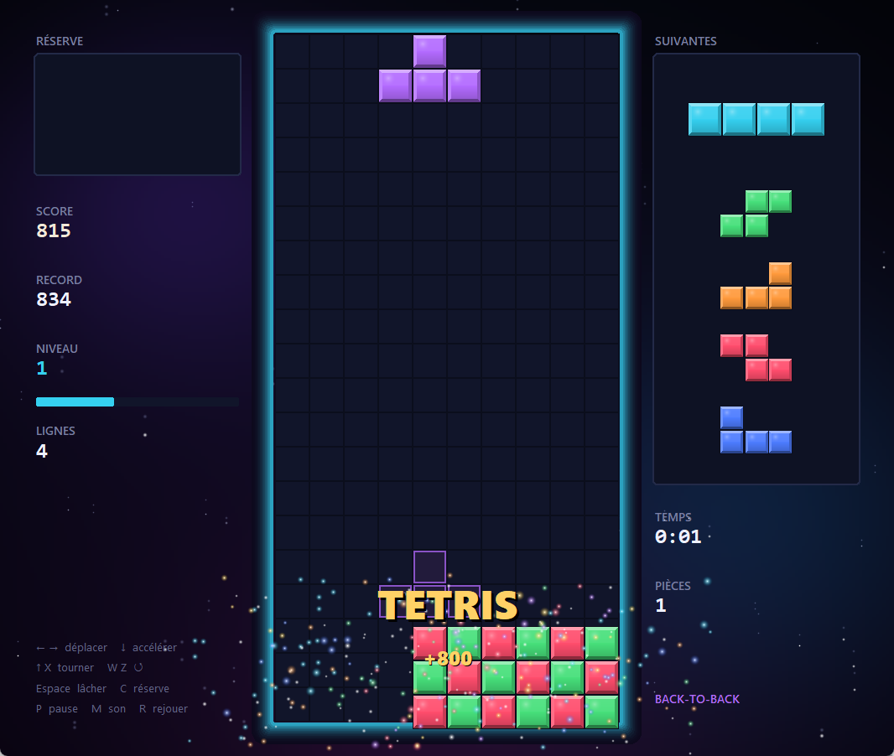
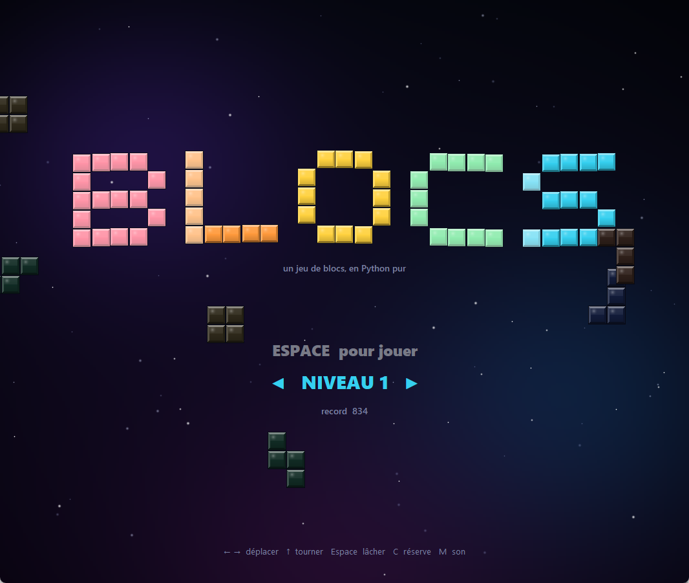

# BLOCS — un jeu de blocs qui tombent, en Python pur



Un Tetris complet et animé, en un seul fichier et **sans aucune
dépendance**. Tout ce qu'on voit et tout ce qu'on entend est fabriqué par
le code : il n'y a aucune image ni aucun son sur le disque.

## Lancer

```bash
python blocs.py              # jouer
python blocs.py --niveau 5   # choisir le niveau de départ
python test_blocs.py         # les tests des règles (29 tests)
```

| Touches            | Action                          |
| ------------------ | ------------------------------- |
| `←` `→`            | déplacer (maintenir = glisser)  |
| `↓`                | descendre plus vite             |
| `↑` ou `X`         | tourner (sens horaire)          |
| `W`, `Z` ou `Ctrl` | tourner (sens anti-horaire)     |
| `ESPACE`           | lâcher la pièce d'un coup       |
| `C` ou `Maj`       | mettre la pièce en réserve      |
| `P` ou `Échap`     | pause                           |
| `R`                | recommencer                     |
| `Q`                | retour au menu (pause, fin)     |
| `M`                | couper le son                   |
| `F`                | afficher les images par seconde |

Sur l'écran titre, `←` `→` choisissent le niveau de départ.



## Score

| Action                        | Points (× niveau)            |
| ----------------------------- | ---------------------------- |
| 1, 2, 3, 4 lignes             | 100, 300, 500, 800           |
| T-spin sans ligne, 1, 2, 3    | 400, 800, 1 200, 1 600       |
| Back-to-back                  | × 1,5 sur un Tetris ou T-spin enchaîné |
| Combo                         | + 50 × combo à chaque ligne enchaînée |
| Plateau vidé (perfect clear)  | + 800 à 2 000                |
| Descente rapide / lâcher      | 1 / 2 par ligne descendue    |

Un **T-spin** consiste à faire tourner le T dans un trou dont au moins 3
des 4 coins sont bouchés. On monte d'un niveau toutes les 10 lignes. Le
meilleur score est gardé dans `.blocs_record.json` (non versionné).

## Ce qui est animé

- **Les pièces glissent** au lieu de sauter de case en case. Chaque case
  rejoint sa place en quelques millisecondes, et comme la case *i* d'une
  rotation est l'image de la case *i* de la précédente, les rotations se
  font aussi en glissant.
- **Lâcher une pièce** laisse une traînée lumineuse et soulève de la
  poussière, puis le plateau rebondit sur un petit ressort amorti.
- **Une pièce au sol** s'éclaire à mesure que son verrouillage approche.
- **Une ligne complète** devient blanche, se désagrège du centre vers les
  bords et explose en particules soumises à la gravité. Les lignes du
  dessus retombent ensuite avec un léger dépassement.
- **Un Tetris** fait trembler l'écran, passe les étoiles en « hyperespace »
  et fait flamber le halo du plateau.
- **Des textes flottants** (« TETRIS », « +1 200 », « COMBO ×3 ») sautent
  à l'écran puis s'effacent en montant.
- **Chaque niveau** a sa couleur : le halo et la barre de progression
  changent de teinte en fondu.
- **Le score défile** jusqu'à sa nouvelle valeur, la file des pièces
  suivantes remonte en glissant, un compte à rebours ouvre la partie, et
  en fin de partie le plateau se couvre de gris de bas en haut.
- **L'écran titre** : les lettres, faites de blocs, tombent en rebondissant
  pendant qu'une pluie de pièces défile en arrière-plan.

## Comment c'est fait, sans aucune bibliothèque

**Les images** sont des fichiers PNG écrits octet par octet :
`zlib.compress` pour les pixels, `struct` pour les en-têtes, `zlib.crc32`
pour les sommes de contrôle. Tk sait afficher un PNG avec sa transparence,
ce qui permet les particules lumineuses et les traînées translucides. Tout
est calculé une fois au démarrage (moins d'une seconde) : blocs en relief
avec reflet, versions éclairées pour les flashs, blocs qui rétrécissent,
fond avec nébuleuses et vignette.

**Les sons** sont synthétisés échantillon par échantillon (ondes carrée,
triangle, sinus et bruit, avec enveloppe), puis normalisés pour avoir tous
le même volume de crête. Pour les jouer, le jeu parle directement à la
carte son de Windows (API `waveOut` de `winmm.dll`, appelée avec `ctypes`).
La sortie audio est ouverte **une seule fois** au démarrage, et un fil
d'exécution lui envoie en continu des blocs de 23 ms dans lesquels il
mélange les sons en cours.

La première version passait par `winsound`, qui rouvre la sortie audio à
chaque son. Ce délai d'ouverture mangeait le début de sons très courts
(45 ms pour une rotation), et on n'entendait presque rien. `winsound` reste
utilisé en secours si `waveOut` refuse de s'ouvrir. Hors de Windows, le jeu
reste muet.

**L'affichage** reste fluide parce que le canevas n'est jamais vidé.
Chaque type d'objet (cases, particules, textes...) a sa réserve d'objets
créés une fois pour toutes. À chaque image, on déclare ce qu'on veut
afficher, et la réserve ne touche au canevas que pour ce qui a changé.
Mesure sur cette machine : **0,4 ms** par image en moyenne, pour une
boucle réglée à 120 images par seconde.

**Le clavier** : une fenêtre reçoit les appuis *et* les relâchements de
touches, ce qu'un terminal ne sait pas faire (c'est ce qui rendait
[CRYPTE](../bonus_moteur_3d/) injouable). Le jeu gère lui-même la
répétition d'un déplacement maintenu : 0,16 s d'attente, puis un pas toutes
les 0,045 s. Il corrige deux pièges des systèmes :

- Windows répète les appuis tant qu'une touche est maintenue : on ignore
  l'appui d'une touche déjà enfoncée.
- Linux envoie un relâchement suivi d'un appui à chaque répétition : on ne
  valide un relâchement qu'après 25 ms, et un appui dans ce délai l'annule.

## Organisation du code

- `Game` contient **toutes les règles** et n'affiche rien. Elle publie des
  événements (`lock`, `clear`, `level`, `harddrop`...) que l'affichage
  transforme en animations et en sons. Elle se teste sans fenêtre.
- `Assets` fabrique les images, `Sound` les sons.
- `App` gère les écrans (titre, compte à rebours, partie, pause, fin), le
  clavier et le dessin.

## Fichiers

| Fichier            | Rôle                          |
| ------------------ | ----------------------------- |
| `blocs.py`         | le jeu, un seul fichier       |
| `test_blocs.py`    | les tests des règles          |
| `apercu*.png`      | captures du jeu               |
