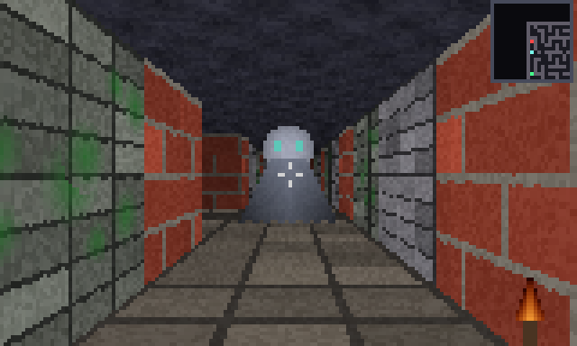

# CRYPTE — un moteur 3D temps réel qui tourne dans le terminal



Ce n'est pas une image : c'est une capture du jeu, qui tourne à plus de
150 images par seconde **dans une fenêtre de terminal**, en Python pur.

Un seul fichier, **zéro dépendance** : uniquement la bibliothèque standard.
Pas de pygame, pas de numpy, pas d'OpenGL, aucune image ni aucun son chargé
depuis le disque — tout est calculé par le code.

## Lancer

```bash
python crypte.py                    # jouer
python crypte.py --bench 200        # mesurer les performances
python crypte.py --capture vue.png  # exporter une image du moteur
python test_crypte.py               # la suite de tests (26 tests)
```

Il faut un terminal qui gère les couleurs 24 bits : Windows Terminal, le
terminal intégré de VS Code, ou n'importe quel terminal Linux/macOS récent.
Agrandissez la fenêtre avant de lancer : le moteur s'adapte à sa taille.

| Touches        | Action              |
| -------------- | ------------------- |
| `Z`/`W` et `S` | avancer, reculer    |
| `Q`/`A` et `D` | pas de côté         |
| flèches        | tourner             |
| `ESPACE`       | tirer               |
| `ECHAP`        | quitter             |

But du jeu : atteindre le portail vert au fond de la crypte sans se faire
rattraper par les spectres.

## Comment un terminal peut afficher de la 3D

Trois idées, empilées.

### 1. Deux pixels par caractère

Un terminal affiche des caractères, pas des pixels. Mais le caractère
demi-bloc `▀` (U+2580) remplit la moitié haute de sa cellule. En lui donnant
une couleur de texte et une couleur de fond différentes, **une cellule
affiche deux pixels** : couleur de texte en haut, couleur de fond en bas.
On double ainsi la résolution verticale, et les séquences ANSI
`\x1b[38;2;R;G;Bm` donnent accès aux 16 millions de couleurs.

Une fenêtre de 160 × 48 caractères devient un écran de 160 × 96 pixels.

### 2. Le lancer de rayons (raycasting)

La technique de *Wolfenstein 3D* (1992). Le décor est une grille : 1 = mur,
0 = sol. Pour chaque colonne de l'écran, on tire un rayon depuis le joueur
et on avance de case en case avec l'algorithme **DDA** jusqu'à toucher un
mur. La distance perpendiculaire au mur donne directement la hauteur de la
colonne à dessiner : proche = haute, loin = basse. C'est de la vraie 3D,
obtenue avec une boucle par colonne au lieu d'un rendu polygonal.

Le sol et le plafond utilisent la projection inverse : sur une même ligne
d'écran, tous les points du sol sont à la même distance du joueur. On
calcule cette distance une fois par ligne, puis on avance dans la texture
par pas constants. Le plafond étant à la même hauteur que le sol, la ligne
symétrique se déduit gratuitement — moitié du travail en moins.

### 3. Tout est généré par le code

- **Le labyrinthe** : backtracking récursif, puis on perce quelques murs au
  hasard pour créer des boucles (un labyrinthe parfait est étouffant à
  parcourir). Un test vérifie sur plusieurs graines qu'aucune salle n'est
  isolée.
- **Les textures** (briques, pierre, mousse, runes, dalles, voûte) : des
  fonctions mathématiques, pas des fichiers image.
- **Les sprites** (spectres, portail) : dessinés en code, avec transparence.
- **Le PNG exporté** par `--capture` : écrit à la main avec `struct` et
  `zlib`, sans Pillow.

## Ce qui rend le tout rapide

Python n'est pas fait pour dessiner 15 000 pixels 45 fois par seconde. Ce
qui fait tenir la cadence :

- **Trois caches.** Une colonne de mur ne dépend que de (texture, position,
  niveau de lumière) : avec 24 niveaux d'éclairage, l'ensemble des colonnes
  possibles tient en mémoire et se calcule une seule fois. Idem pour la
  correspondance hauteur de mur → pixels de texture, et pour les textures de
  sol assombries.
- **La transposition en C.** L'image est construite colonne par colonne
  (l'ordre naturel du lancer de rayons) puis transposée d'un coup avec
  `zip(*colonnes)`, qui travaille en C.
- **Le découpage de listes.** Remplir une colonne, c'est une affectation de
  tranche, pas une boucle Python.
- **Les codes couleur compressés.** On n'émet une séquence ANSI que lorsque
  la couleur change : sur une image réelle cela divise la taille de la trame
  par trois ou quatre.

Mesure sur cette machine (`python crypte.py --bench 200`) :

```
resolution      140 x 84 pixels (140 x 42 cellules)
cadence         156.7 images/seconde
trame moyenne   131.9 Ko
```

Soit trois fois la cadence visée. Le jeu est volontairement bridé à 45 FPS
pour ne pas faire tourner le ventilateur pour rien.

## Le clavier, dans un terminal

Un terminal ne signale jamais le **relâchement** d'une touche : on ne reçoit
que des appuis. Une boucle de jeu naïve donne donc un déplacement saccadé.

La solution retenue : on considère qu'une touche reste enfoncée pendant
0,22 seconde après le dernier appui reçu. La répétition automatique du
clavier rafraîchit ce délai tant que la touche est maintenue, et le
déplacement paraît continu. La lecture elle-même est non bloquante, via
`msvcrt` sur Windows et `termios`/`select` ailleurs.

## Tests

```bash
python test_crypte.py
```

26 tests avec `unittest` : connexité du labyrinthe, collisions et glissement
le long des murs, portée et angle de tir, occultation par les murs, temps de
recharge, poursuite des spectres, conditions de victoire et de défaite,
dimensions et validité de l'image, bornage des caches.

Le rendu est testable sans terminal : le moteur produit une liste de pixels,
et la boucle de jeu ne lit le clavier qu'à travers un objet remplaçable par
un faux clavier.

## Fichiers

| Fichier           | Rôle                                         |
| ----------------- | -------------------------------------------- |
| `crypte.py`       | le moteur et le jeu, un seul fichier         |
| `test_crypte.py`  | la suite de tests                            |
| `apercu.png`      | l'image ci-dessus, produite par `--capture`  |
| `requirements.txt`| vide, et c'est le sujet                      |
